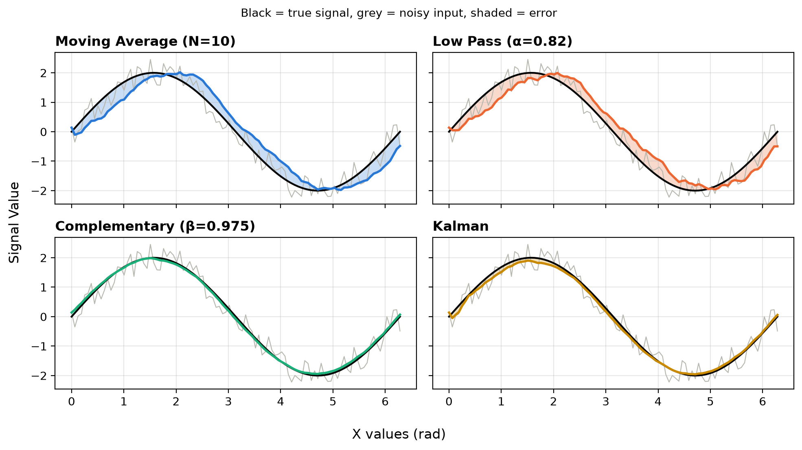

# Signal Filtering: Comparing Classic Filters on Synthetic Data

A hands-on comparison of four classic digital filters (**Moving Average**, **First-Order Low-Pass**, **Complementary** and **Kalman**) on a noisy synthetic sine wave. The filters will later be applied to real-time data from an **MPU-6050 IMU** in a separate GitHub repository (link coming soon).

### 📄 [Read the full report (results/results.pdf)](results/results.pdf)

**Quick links:** [Results](#results) · [Full report (PDF)](results/results.pdf) · [Getting started](#getting-started) · [Repository structure](#repository-structure)


## Project Roadmap

|Phase|Description|Status|
|-|-|-|
|1|Generate noisy synthetic sine data|✅ Done|
|2|Implement moving average filter|✅ Done|
|3|Implement first-order low-pass filter|✅ Done|
|4|Implement complementary filter|✅ Done|
|5|Implement 1D Kalman filter|✅ Done|
|6|Compare all filters (RMSE, lag, residual noise, amplitude attenuation)|✅ Done|
|7|Compile results into [`results/results.pdf`](results/results.pdf)|✅ Done|


## Phase Descriptions

**Phase 1: Synthetic Data Generation**
Generate a clean sine wave as ground truth. Add uniform random noise to simulate a noisy sensor reading.

**Phase 2: Moving Average Filter**
Average the last N samples. Observe how the window size affects smoothness and delay.

**Phase 3: First-Order Low-Pass Filter**
Smooth the noisy signal with exponential smoothing. Study how the smoothing factor α trades noise suppression against lag.

**Phase 4: Complementary Filter**
Fuse two simulated sources with complementary noise behaviour: a noisy "accelerometer" signal and a biased, noisy "gyroscope" rate signal.

**Phase 5: Kalman Filter**
Implement a 1D Kalman filter that fuses the same two sources. Estimate the rate bias, measurement noise (R) and process noise (Q) from stationary calibration readings, and compute the gain at every step.

**Phase 6: Filter Comparison**
Run all filters on the same data, evaluate each one using the metrics below, and repeat the test over 50 different noise patterns.

**Phase 7: Results Report**
Compile all graphs, metric tables, theory-vs-measurement comparisons and observations into [`results/results.pdf`](results/results.pdf).


## Comparison Metrics

|Metric|What it measures|
|-|-|
|**RMSE**|Overall error between the filtered signal and the true signal (lower is better)|
|**Lag**|How far the filtered signal trails the true signal: the shift that gives the lowest RMSE|
|**Residual noise**|Standard deviation of the error after removing the lag, so noise is measured separately from delay|
|**Amplitude attenuation**|Peak-to-peak of the filtered signal divided by that of the true signal (1 = full height)|

Step response, frequency response, drift with an uncorrected bias, computational cost and parameter sensitivity are left as future work.


## Results

Settings: moving average N = 10, low-pass α = 0.82, complementary β = 0.975, Kalman with bias, R and Q estimated from calibration. The moving average and low-pass settings were chosen to have the same theoretical lag, so they can be compared fairly.



*Black is the true signal, grey is the noisy input, and the shaded area is each filter's error.*

**Average over 50 different noise patterns (mean ± std):**

|Signal|RMSE|Lag (rad)|Residual noise|Attenuation|
|-|-|-|-|-|
|Raw (no filter)|0.291 ± 0.013|0.006 ± 0.019|0.291 ± 0.013|1.196 ± 0.026|
|Moving average|0.386 ± 0.030|0.273 ± 0.033|0.096 ± 0.020|1.006 ± 0.022|
|Low-pass|0.373 ± 0.031|0.265 ± 0.029|0.109 ± 0.020|0.988 ± 0.021|
|Complementary|0.126 ± 0.062|0.000|0.086 ± 0.036|0.985 ± 0.034|
|Kalman|**0.083 ± 0.020**|0.000|**0.071 ± 0.019**|0.988 ± 0.020|

**Key findings**

- **Moving average and low-pass filters remove noise but add lag.** They cut the noise by about 65%, but they are so late that their total error is *worse* than no filter at all.
- **Using the rate removes the lag.** The complementary and Kalman filters predict where the signal is going, so they smooth the signal with no measurable lag and cut the error by 57% and 72%.
- **The Kalman filter is the most reliable.** It beat the complementary filter in 36 of 50 runs and varies the least between runs. Its gain started at 0.50 and settled at 0.026, almost exactly the 0.025 chosen by hand for the complementary filter.
- **The results agree with theory** to within one sample for lag and a few percent for noise.

➡️ **The full report, with the theory-vs-measurement table, the Kalman gain plot and the 50-run comparison, is in [`results/results.pdf`](results/results.pdf).**

Raw numbers: [`results/metrics.csv`](results/metrics.csv) (seed 42) and [`results/metrics_50_seeds.csv`](results/metrics_50_seeds.csv) (50 seeds).


## Getting Started

```bash
git clone https://github.com/sahai-aditya/signal-filtering.git
cd signal-filtering
pip install -r requirements.txt

python main.py kalman      # one filter: moving_average | low_pass | complementary | kalman
python analysis.py         # compare all filters, save results/metrics.csv and the overlay plot
python report.py           # make every figure in the report + 50-seed statistics
```

To rebuild the report (needs a LaTeX distribution such as MiKTeX or TeX Live):

```bash
cd results
pdflatex results.tex
pdflatex results.tex       # run twice so figure numbers appear
```


## Repository Structure

```
signal-filtering/
├── filters/                  # filter classes, one sample per update() call
│   ├── moving_average_filter.py
│   ├── low_pass_filter.py
│   ├── complementary_filter.py
│   └── kalman_filter.py
├── utils.py                  # synthetic data, calibration readings, single-filter plots
├── metrics.py                # RMSE, lag, residual noise, attenuation
├── main.py                   # run one filter from the command line
├── analysis.py               # compare all filters on the same data
├── report.py                 # every figure in the report + 50-seed test
└── results/
    ├── results.pdf           # 📄 final report
    ├── results.tex           # report source (LaTeX)
    ├── metrics.csv           # metrics from the seeded run (seed 42)
    ├── metrics_50_seeds.csv  # mean and std. dev. over 50 seeds
    └── figures/              # figures used in the report
```


## Author

**Aditya Sahai**, M.Sc. Physics + B.E. Mechanical Engineering, BITS Pilani
